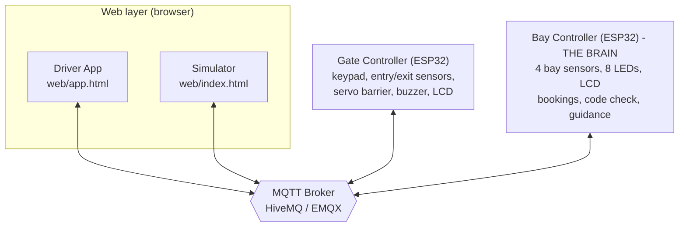
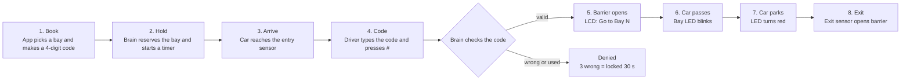

# Smart Carpark

An IoT smart carpark built from **two ESP32 boards** and **two web pages**, all talking over **MQTT**.
Drivers book a bay in a web app and get a 4-digit code. At the gate they type the code on a keypad, the barrier opens, and LEDs guide them to the right bay. Cars without a booking can still walk in, as long as the carpark is not full.

Everything runs in the [Wokwi](https://wokwi.com) simulator, so **no physical hardware is needed**.

---

## Demo video

https://github.com/user-attachments/assets/93370f46-7884-473d-9182-7d2097df2839

---

## Table of contents

1. [Features](#features)
2. [Architecture](#architecture)
3. [How it works](#how-it-works)
4. [Setup and run](#setup-and-run)
5. [Try it: test scenarios](#try-it-test-scenarios)
6. [LED and LCD legend](#led-and-lcd-legend)
7. [Project structure](#project-structure)

---

## Features

- **Booking with a 4-digit code.** The driver picks a free bay in the app, gets a code, and the bay is held for a limited time (default 120 s).
- **Keypad gate.** 4x4 keypad, entry/exit ultrasonic sensors, servo barrier, buzzer and LCD.
- **Walk-in mode.** Press `A` on the keypad to enter without a booking, if a free unbooked bay exists.
- **Guided parking.** The green LED of the target bay blinks to show the driver where to go.
- **Brute-force protection.** 3 wrong codes lock the keypad for 30 seconds.
- **Live status.** Retained MQTT messages let any page that connects later see the current state instantly.
- **No cloud account needed.** Uses a free public MQTT broker (HiveMQ or EMQX).

---

## Architecture

**The Bay Controller is the brain, the Gate Controller is the hands.**
The gate stores no booking data. It only asks the brain "may this car in?" and obeys the answer.



| Part | File | Role |
| --- | --- | --- |
| Driver App | `web/app.html` | Pick a bay, book it, get the code, drive in, cancel |
| Simulator | `web/index.html` | Animated carpark: moves virtual cars, fakes sensor distances, sets hold time, reset |
| Gate Controller | `gate/src/main.cpp` | Reads keypad and sensors, asks the brain, moves the barrier |
| Bay Controller | `bays/src/main.cpp` | Owns bays, bookings, timers, car count and guidance |

---

## How it works



**Walk-in:** press `A` at the gate. The brain answers `ok` (take any free bay), `full` (no free unbooked bay) or `busy` (another car is still passing through).

**Keypad keys:** `0-9` type the code, `*` clears, `#` confirms, `A` is walk-in.

---

## Setup and run

### Setup video

The full VS Code setup (extensions, build, Wokwi license, starting both simulations) is shown step by step in this video (about 10 minutes):

<video src="how%20to%20setup%20project%20in%20vscode.mp4" controls width="100%"></video>

If the player does not load, [open the setup video directly](how%20to%20setup%20project%20in%20vscode.mp4).

### Quick checklist

You need:

- [Visual Studio Code](https://code.visualstudio.com/) with the **PlatformIO IDE** and **Wokwi Simulator** extensions
- A free [Wokwi](https://wokwi.com) account (for the simulator license)
- An internet connection (public MQTT broker and `mqtt.js` from a CDN)

Then, in short:

1. Download or clone this repo.
2. Build both firmwares once: `cd bays && pio run` and `cd gate && pio run` (the first build is slow).
3. In VS Code press `F1` and run **Wokwi: Request a New License** (one time).
4. Open `bays/` in one VS Code window and `gate/` in another. In each, press `F1` and run **Wokwi: Start Simulator**. Wait for `MQTT connecting... ok` in the serial output.
5. Open `web/index.html` (Simulator) and `web/app.html` (Driver App) in your browser. Both should show a green "Broker connected" chip.

> **Windows only:** if the build fails with "path too long", uncomment the `core_dir = C:\pio` line in `bays/platformio.ini` and `gate/platformio.ini`.

---

## Try it: test scenarios

**Keep the Simulator page open while using the Driver App.** The "Drive to the carpark" button sends a message that the Simulator turns into a moving car.

| # | Scenario | What to do | Expected result |
| --- | --- | --- | --- |
| 1 | Booked car | Book a bay in the Driver App, then tap **Drive to the carpark** | Gate LCD shows `Code: ____`, the code is entered, barrier opens, `Go to Bay N`, bay LED blinks then turns red |
| 2 | Wrong code | Send a car in and type a wrong code on the gate keypad | `Wrong code` with tries left. After 3 wrong codes the keypad locks for 30 s |
| 3 | Walk-in | Send a car in and press `A` | Admitted if a free unbooked bay exists |
| 4 | Carpark full | Fill or book all bays, send another car, press `A` | LCD shows `Carpark FULL` |
| 5 | Booking expires | Use **Set hold time** in the Simulator (for example 15 s), book a bay, wait | Bay is released automatically |
| 6 | Cancel | Book a bay, tap **Cancel booking** | Bay goes back to green |

To leave, use **Car leaves** in the Simulator. Use **Reset** at any time to return to a clean state.

---

## LED and LCD legend

| Bay LED | Meaning |
| --- | --- |
| Green only | Free |
| Red only | Occupied |
| Green + Red | Booked, waiting for its car |
| Green blinking | Drive to this bay |

Bay Controller LCD: `Free:N R:N In:N` (free bays, reserved bays, cars inside), plus `Ready`, `Go to Bay N` or `FULL - NO ENTRY` on the second line.

---

## Project structure

```
.
├── bays/                  Bay Controller (the brain)
│   ├── src/main.cpp
│   ├── platformio.ini
│   ├── diagram.json       Wokwi circuit
│   └── wokwi.toml
├── gate/                  Gate Controller
│   ├── src/main.cpp
│   ├── platformio.ini
│   ├── diagram.json
│   └── wokwi.toml
├── web/
│   ├── index.html         Simulator
│   └── app.html           Driver App
├── how to setup project in vscode.mp4   Setup video
├── LICENSE
└── README.md
```

---

## About

A university IoT project (Bachelor of Information Technology, Computer Networks, SEGi University).

## License

MIT License. See the `LICENSE` file.
