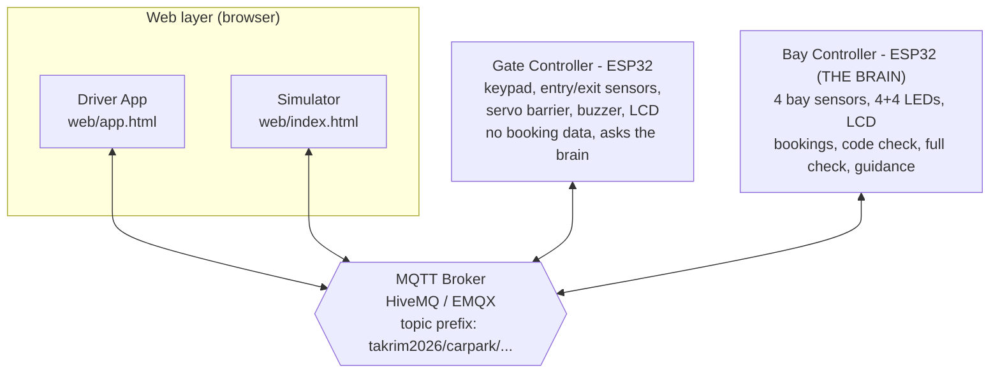
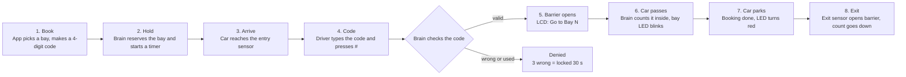

# Smart Carpark

An IoT smart carpark built from **two ESP32 boards** and **two web pages**, all talking to each other over **MQTT**.
Drivers book a bay in a web app and get a 4-digit code. At the gate they type the code on a keypad, the barrier opens, and LEDs guide them to the right bay. Cars without a booking can still walk in, as long as the carpark is not full.

Everything runs in the [Wokwi](https://wokwi.com) simulator, so **no physical hardware is needed** to try it. The same firmware is written to run on real ESP32 boards too.

**[Watch the demo video](demo.mp4)** (the file `demo.mp4` in this repo; GitHub plays it in the browser).

---

## Table of contents

1. [Features](#features)
2. [Architecture](#architecture)
3. [How it works](#how-it-works)
4. [Hardware and pin map](#hardware-and-pin-map)
5. [Requirements](#requirements)
6. [Setup and run (step by step)](#setup-and-run-step-by-step)
7. [Try it: test scenarios](#try-it-test-scenarios)
8. [Configuration](#configuration)
9. [MQTT topics](#mqtt-topics)
10. [LED and LCD legend](#led-and-lcd-legend)
11. [Moving to real hardware](#moving-to-real-hardware)
12. [Security notes](#security-notes)
13. [Troubleshooting](#troubleshooting)
14. [Project structure](#project-structure)

---

## Features

- **Booking with a 4-digit code.** The driver picks a free bay in the app, gets a code, and the bay is held for a limited time (default 120 s).
- **Keypad gate.** A 4x4 keypad, entry/exit ultrasonic sensors, a servo barrier, a buzzer and an LCD.
- **Walk-in mode.** Press `A` on the keypad to enter without a booking. The system checks whether a bay is really available.
- **Smart "FULL" check.** Booked bays and bays already promised to a car in transit are not counted as free.
- **Guided parking.** The green LED of the target bay blinks to show the driver where to go.
- **Brute-force protection.** 3 wrong codes lock the keypad for 30 seconds.
- **Single car at a time** through the gate, so two cars cannot be let in on one code.
- **Live status.** Retained MQTT messages mean any web page that connects later instantly sees the current state.
- **Works with no cloud account.** It uses a free public MQTT broker (HiveMQ or EMQX).

---

## Architecture

The key idea: **the Bay Controller is the brain, the Gate Controller is the hands.**
The gate stores no booking data. It only asks the brain "may this car in?" and obeys the answer.



| Part | File | Role |
| --- | --- | --- |
| Driver App | `web/app.html` | Pick a bay, book it, get the code, drive in, cancel |
| Simulator | `web/index.html` | Animated carpark: moves virtual cars, fakes sensor distances, sets hold time, reset |
| Gate Controller | `gate/src/main.cpp` | Physical gate: reads keypad and sensors, asks the brain, moves the barrier |
| Bay Controller | `bays/src/main.cpp` | The brain: owns bays, bookings, timers, car count and guidance |
| MQTT Broker | cloud (HiveMQ / EMQX) | Message hub. Nothing talks to anything else directly |

---

## How it works

### Booking and entry flow



### Walk-in (no booking)

1. Car stops at the entry sensor. The LCD shows `Code: ____`.
2. Driver presses **`A`**.
3. The brain answers `busy` (another car is still driving through), `full` (no free and unbooked bay), or `ok` (take any free bay).
4. After the car passes, the first free unbooked bay blinks green.

### What each controller is responsible for

**Gate Controller** (`gate/`): a state machine with `IDLE`, `WAIT_CODE`, `CHECKING`, `OPEN_ENTRY`, `OPEN_EXIT`, `DENIED`, `LOCKED`. It debounces its sensors, collects the code, sends requests, and opens or closes the barrier. It never closes the barrier while a car is still on the sensor.

**Bay Controller** (`bays/`): reads 4 sensors with a median filter and hysteresis (a bay becomes occupied under 40 cm and free again above 55 cm, so it does not flicker). It tracks bookings, expires them when the timer ends, decides who may enter, counts cars inside, and publishes everything as retained status messages.

### Booking lifecycle

A booking goes **Booked, then Arrived, then Done**. It can also end as **Expired** (hold time ran out) or **Cancelled**. If a booking expires while the car is already inside, that car is simply guided to any free bay.

---

## Hardware and pin map

### Bay Controller (ESP32 DevKit)

| Function | Pins |
| --- | --- |
| HC-SR04 TRIG (bays 1-4) | 4, 5, 16, 17 |
| HC-SR04 ECHO (bays 1-4) | 34, 35, 36, 39 |
| Green LEDs (bays 1-4) | 13, 23, 14, 27 |
| Red LEDs (bays 1-4) | 26, 25, 33, 32 |
| LCD 16x2 (I2C, address `0x27`) | SDA 21, SCL 22 |

### Gate Controller (ESP32 DevKit)

| Function | Pins |
| --- | --- |
| Entry HC-SR04 | TRIG 4, ECHO 34 |
| Exit HC-SR04 | TRIG 5, ECHO 35 |
| Servo barrier | 18 |
| Buzzer | 19 |
| 4x4 keypad rows | 13, 14, 27, 26 |
| 4x4 keypad columns | 25, 33, 32, 23 |
| LCD 16x2 (I2C, address `0x27`) | SDA 21, SCL 22 |

Keypad keys: `0-9` type the code, `*` clears, `#` confirms, `A` is walk-in (no booking). `B`, `C` and `D` are not used.

---

## Requirements

### Software

| Tool | Why | Notes |
| --- | --- | --- |
| [Visual Studio Code](https://code.visualstudio.com/) | Editor and simulator host | Latest version |
| [PlatformIO IDE extension](https://platformio.org/install/ide?install=vscode) | Builds the ESP32 firmware | Libraries and the ESP32 toolchain download automatically on first build |
| [Wokwi for VS Code extension](https://marketplace.visualstudio.com/items?itemName=wokwi.wokwi-vscode) | Runs the simulated ESP32 boards | Needs a free license (see setup step 4) |
| A modern web browser | Runs the two web pages | Chrome, Edge or Firefox |
| Git | Clone the repo | Optional if you download the ZIP instead |
| Python 3 | Only to serve the web pages locally | Optional, you can double-click the HTML files instead |

### Accounts and network

- **Internet connection.** The firmware uses a public MQTT broker and the web pages load `mqtt.js` from a CDN.
- **A free Wokwi account** to get the simulator license.
- No MQTT account or paid service is needed.

### Pinned versions (already set in `platformio.ini`)

- Platform: `espressif32@6.9.0`, board `esp32doit-devkit-v1`, Arduino framework
- Libraries: PubSubClient, LiquidCrystal_I2C, ESP32Servo and Keypad (gate only)
- Web pages: `mqtt.js@5.10.1`

---

## Setup and run (step by step)

### 1. Get the code

On this page click the green **Code** button. Either choose **Download ZIP** and unzip it, or copy the link and clone it:

```bash
git clone <the link you copied from the Code button>
cd <the folder that git created>
```

### 2. Install the VS Code extensions

Install **PlatformIO IDE** and **Wokwi Simulator** from the VS Code Extensions panel. Restart VS Code if asked.

> **Windows only:** if the build fails with "path too long", open `bays/platformio.ini` and `gate/platformio.ini` and uncomment the `core_dir = C:\pio` line.

### 3. Build both firmwares

The simulator needs a compiled `firmware.bin`, so build first. Do this once per folder (the first build is slow because it downloads the toolchain).

```bash
cd bays && pio run && cd ..
cd gate && pio run && cd ..
```

If you prefer the GUI: open the folder in VS Code, click the PlatformIO tick icon (**Build**) in the bottom bar.

Success looks like `[SUCCESS]` at the end, and a `.pio/build/esp32doit-devkit-v1/firmware.bin` file in each folder.

### 4. Activate the Wokwi license (one time)

In VS Code press `F1`, run **Wokwi: Request a New License**, and log in with your free Wokwi account in the browser tab that opens.

### 5. Start the two simulations

Each simulation needs its **own VS Code window**:

1. **Window A:** open the `bays/` folder, press `F1`, run **Wokwi: Start Simulator**.
2. **Window B:** open the `gate/` folder, press `F1`, run **Wokwi: Start Simulator**.

Watch the serial output in each window. You should see:

```
WiFi connected
MQTT connecting... ok
```

The Wokwi simulation can run slower than real time. That is normal. The firmware sends a heartbeat every 2 seconds so the broker does not disconnect it.

### 6. Open the web pages

The pages are plain static HTML. Pick either way:

```bash
# Option A: just open the files
#   web/index.html   (Simulator)
#   web/app.html     (Driver App)

# Option B: serve them locally
cd web
python3 -m http.server 8080
# then open http://localhost:8080/index.html and http://localhost:8080/app.html
```

Open **both pages**. Each shows a green "Broker connected" chip when it is online.

### 7. Check everything is connected

- Simulator page shows the gate display and the 4 bays.
- Both pages must use the **same topic prefix and broker** as the firmware (the defaults already match, see [Configuration](#configuration)).

---

## Try it: test scenarios

**Keep the Simulator page (`index.html`) open while using the Driver App.** The "Drive to the carpark" button sends a message that the Simulator page turns into a moving car. Without the Simulator open, the car will not start.

### Scenario 1: booked car (the full flow)

1. In the **Driver App**, pick a free bay and tap **Book a bay**. You get a 4-digit code and a countdown.
2. Tap **Drive to the carpark**. A car drives to the entry in the Simulator.
3. The gate LCD shows `Code: ____`. The Simulator enters the booked code on the gate keypad and confirms with `#` for you (you can also type it yourself on the keypad in the gate's Wokwi window).
4. The barrier opens and the LCD shows `Go to Bay N`.
5. The car drives in, the bay's green LED blinks, the car parks, and the LED turns red.
6. Use **Car leaves** in the Simulator to drive it out through the exit.

### Scenario 2: wrong code

Send a car in and type a wrong code on the gate keypad (in the gate's Wokwi window). The LCD shows `Wrong code` and the tries left. After 3 wrong codes the keypad locks for 30 s.

### Scenario 3: walk-in

Send a car in and press **`A`**. It is admitted if a free, unbooked bay exists.

### Scenario 4: carpark full

Fill all bays (or book them all), then send another car and press `A`. The LCD shows `Carpark FULL`.

### Scenario 5: booking expires

Use **Set hold time** in the Simulator to make the hold short (for example 15 s), book a bay, and wait. The bay is released automatically.

### Scenario 6: cancel

Book a bay, then tap **Cancel booking** in the Driver App. The bay goes back to green.

Use **Reset** in the Simulator at any time to return to a clean state (cars inside = 0).

---

## Configuration

The values below must match in **all four places**: `bays/src/main.cpp`, `gate/src/main.cpp`, `web/index.html`, `web/app.html`.

| Setting | Default | Where |
| --- | --- | --- |
| `PREFIX` (topic prefix) | `takrim2026/carpark/k7q2x9m4` | Top of both `main.cpp` files. In the web pages it is the **Topic prefix** field (also saved in the browser) |
| `MQTT_HOST` | `broker.hivemq.com` | Both `main.cpp` files. Alternative: `broker.emqx.io` |
| Broker (web pages) | HiveMQ | Dropdown in the Connection panel |
| `USE_TLS` | `false` | Both `main.cpp` files. `false` = port 1883 (fast in Wokwi). `true` = port 8883 with TLS |
| Booking hold time | 120 s | Simulator page, **Set hold time** (10 to 3600 s) |
| Occupied threshold | under 40 cm (free above 55 cm) | `OCC_ENTER_CM` / `OCC_EXIT_CM` in `bays/src/main.cpp` |
| Entry detection | under 60 cm | `NEAR_CM` in `gate/src/main.cpp` |
| Max wrong codes / lock time | 3 tries / 30 s | `MAX_TRIES` / `LOCK_MS` in `gate/src/main.cpp` |

The Driver App also accepts the prefix in the URL: `app.html?prefix=your/own/prefix`.

After changing any firmware value, rebuild with `pio run` and restart the simulation.

---

## MQTT topics

All topics start with the prefix, written here as `PREFIX/`.

### Gate and brain

| Topic | Direction | Payload |
| --- | --- | --- |
| `PREFIX/gate/req` | gate to brain | `verify:REQ:CODE`, `walkin:REQ`, `passed:REQ`, `abort:REQ`, `left` |
| `PREFIX/gate/res` | brain to gate | `REQ:ok:BAY` (BAY `0` = any free bay), `REQ:invalid`, `REQ:used`, `REQ:full`, `REQ:busy` |

### Inputs (from the web pages)

| Topic | Payload | Handled by |
| --- | --- | --- |
| `PREFIX/sim/book` | `BAY:CODE`, for example `3:4821` | Bay Controller |
| `PREFIX/sim/cancel` | `CODE` | Bay Controller |
| `PREFIX/sim/hold` | seconds | Bay Controller |
| `PREFIX/sim/slot/1..4` | distance in cm | Bay Controller |
| `PREFIX/sim/gs/entry`, `sim/gs/exit` | distance in cm | Gate Controller |
| `PREFIX/sim/key` | one key: `0-9 * # A` | Gate Controller |
| `PREFIX/sim/arrive` | `CODE` | Simulator page (starts a booked car) |
| `PREFIX/sim/reset` | any | Both controllers |

### Status (published by the boards, mostly retained)

| Topic | Meaning |
| --- | --- |
| `PREFIX/status/slot/N` | `occupied` or `free` |
| `PREFIX/status/available` | free and unbooked bays |
| `PREFIX/status/inside` | cars currently inside |
| `PREFIX/status/suggest` | bay to guide to (`0` = none) |
| `PREFIX/status/reserve/N` | `none` or `CODE:secondsLeft:arrived` |
| `PREFIX/status/event` | `entry-ok:ID`, `exit-ok`, and `book-ok`, `book-denied`, `book-expired`, `book-done`, `book-cancelled`, each followed by `:CODE` (for example `book-ok:4821`) |
| `PREFIX/status/gate`, `gatelcd`, `gateresult` | barrier state, gate LCD text, last gate result |
| `PREFIX/status/online`, `gateonline` | board online or offline (MQTT last will) |
| `PREFIX/status/hold` | booking hold time in seconds (retained) |
| `PREFIX/status/bayhb`, `gatehb` | heartbeat from each board every 2 s, keeps the broker connection alive (not retained) |

---

## LED and LCD legend

| Bay LED | Meaning |
| --- | --- |
| Green only | Free |
| Red only | Occupied |
| Green + Red | Booked, waiting for its car |
| Green blinking | Drive to this bay |

Bay Controller LCD: `Free:N R:N In:N` (free bays, reserved bays, cars inside), and a second line with `Ready`, `Go to Bay N` or `FULL - NO ENTRY`.

---

## Moving to real hardware

The firmware is written for real ESP32 DevKit boards too. Before wiring it up:

1. **Voltage divider on every ECHO pin.** HC-SR04 outputs 5 V but the ESP32 pins are 3.3 V. Use a 1 kOhm + 2 kOhm divider.
2. **Resistor on every LED.** Put a resistor (about 220 Ohm) in series with each of the 8 bay LEDs, as in the Wokwi circuit.
3. **Set real WiFi credentials.** Replace `WIFI_SSID` and `WIFI_PASS` (currently the Wokwi-only `Wokwi-GUEST`).
4. **Remove the fixed WiFi channel.** Both firmwares call `WiFi.begin(WIFI_SSID, WIFI_PASS, 6)`. The `6` forces channel 6, which is right for Wokwi only. Change it to `WiFi.begin(WIFI_SSID, WIFI_PASS)` so the board can join your router on any channel.
5. **Turn on TLS.** Set `USE_TLS = true` (port 8883). Pin the broker certificate instead of `setInsecure()` for a real product.
6. **Use a private broker** with a username and password instead of a public one.
7. **Power the servo separately** from a 5 V supply (common ground with the ESP32).

---

## Security notes

This project is a **demo**. Be aware of these limits:

- **The public broker is open.** Anyone who knows your topic prefix can read the carpark state and send commands. The prefix acts as the only "password".
- **Change the `PREFIX` before you deploy anything real**, and do not keep a real prefix in a public repo. Use a long random string.
- **The 4-digit code is only 10,000 possibilities.** The 3-try lockout helps at the keypad, but anyone on MQTT can publish directly. A real system needs authenticated brokers (username, password, per-client ACLs).
- Messages from the network are length-limited and sanitised in the firmware (letters and digits only), so garbage input cannot crash the boards.

---

## Troubleshooting

| Problem | Fix |
| --- | --- |
| Web page chip says "Connecting" forever | Check your internet. Try the other broker in the dropdown (and change `MQTT_HOST` in the firmware to match). |
| Gate says `System offline` | The gate is not connected to MQTT yet. Wait for `MQTT connecting... ok` in its serial log. |
| Gate says `No answer` | The Bay Controller is not running, or the prefix is different. Start the `bays/` simulation and check the prefix matches. |
| "Drive to the carpark" does nothing | Open `web/index.html` (the Simulator). It is what creates the car. |
| Wokwi says firmware not found | Run `pio run` in that folder first (see step 3). |
| Build fails on Windows with a long path | Uncomment `core_dir = C:\pio` in `platformio.ini`. |
| Simulation is slow | Normal for Wokwi. The web simulator handles gate sensor events instantly to compensate. |
| Old booking stuck after a restart | Use **Reset** in the Simulator. The Bay Controller also clears retained bookings when it reconnects. |
| Two people see each other's cars | You share a public broker and prefix. Change `PREFIX` everywhere. |

---

## Project structure

```
.
├── bays/                  Bay Controller (the brain), PlatformIO + Wokwi project
│   ├── src/main.cpp
│   ├── platformio.ini
│   ├── diagram.json       Wokwi circuit
│   └── wokwi.toml
├── gate/                  Gate Controller, PlatformIO + Wokwi project
│   ├── src/main.cpp
│   ├── platformio.ini
│   ├── diagram.json
│   └── wokwi.toml
├── web/
│   ├── index.html         Simulator
│   └── app.html           Driver App
├── demo.mp4               Demo video
├── LICENSE
└── README.md
```

---

## About

A university IoT project (Bachelor of Information Technology, Computer Networks, SEGi University).

## License

MIT License. See the `LICENSE` file.
